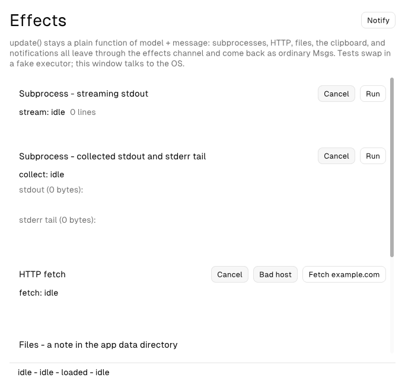
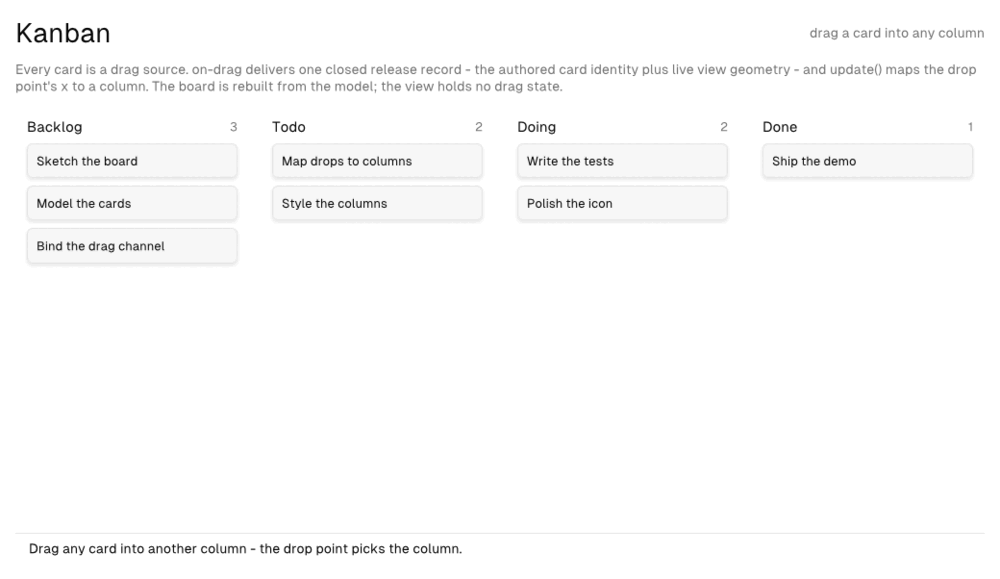
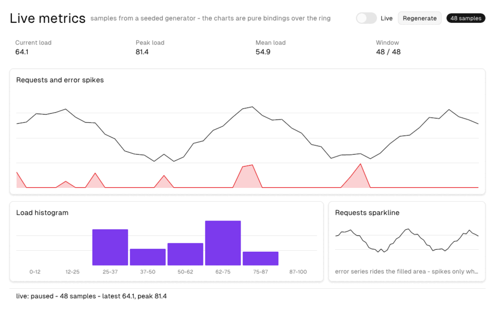
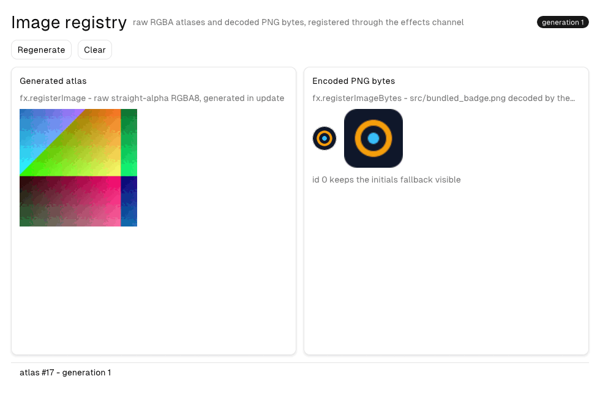
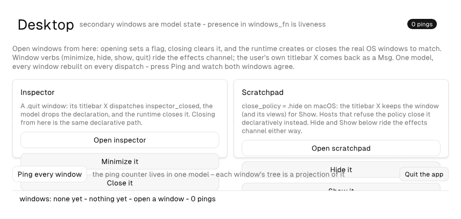
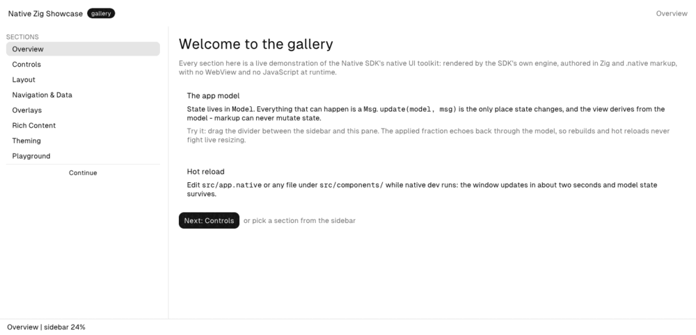

# native-zig-showcase

[](https://github.com/devstroop/native-zig-showcase/actions/workflows/ci.yml)

A complete, professionally maintained demonstration of the
[Native SDK](https://native-sdk.dev) native GUI toolkit **written in
Zig** — every element, layout rule, gesture, effect, and desktop
integration the SDK offers, spread across one flagship gallery app and a
set of focused demos.

No WebView, no npm, no JavaScript at runtime: each app is a Zig core
(`Model` / `Msg` / `update`) plus declarative `.native` markup, built
and run entirely by the `native` CLI.

## Apps

| App | What it demonstrates |
|---|---|
| `apps/counter` | The app-model loop: state, messages, effects (timer, clock) |
| `apps/effects` | The effects channel: subprocesses, HTTP, files, clipboard, notifications |
| `apps/kanban` | Drag and drop: the `on-drag` release record drives a reorderable board |
| `apps/charts` | Data visualization: line, area, bar, and sparkline series over a live effects-channel timer |
| `apps/stream` | Windowed virtual lists: a 100,000-event feed where only the visible slice is ever built |
| `apps/images` | The image registry: raw RGBA atlases and decoded PNG bytes bound as model-owned ids |
| `apps/desktop` | Multi-window: model-declared secondary windows, window verbs (close/minimize/hide/show/quit), close policies, hidden-titlebar chrome |
| `apps/gallery` | ★ The flagship — all ~50 elements, layout, theming, gestures, with self-documenting markup |

## Screenshots

Current capture of every app, rendered by the runtime's deterministic
reference renderer (`native automate screenshot`; regenerate with
`scripts/screenshots.sh`):

| App | Preview |
|---|---|
| `apps/counter` |  |
| `apps/effects` |  |
| `apps/kanban` |  |
| `apps/charts` |  |
| `apps/stream` |  |
| `apps/images` |  |
| `apps/desktop` |  |
| `apps/gallery` |  |

## Docs

- `FEATURES.md` — which SDK surface is demonstrated where
- `docs/` — vendored Native SDK reference guides (checkout-readable
  without the SDK installed)
- `docs/screenshots/` — the captures used above, refreshed by
  `scripts/screenshots.sh`

## Getting started

Install the Native SDK CLI (`native`), then start with the gallery:

```sh
cd apps/gallery
native dev
```

## Commands (any app)

```sh
native dev     # Debug build + run, markup hot reload
native test    # headless update-logic tests
native check   # validate markup, bindings, and manifest
native build   # ReleaseFast binary in zig-out/bin/
```

Repo-wide helpers:

```sh
scripts/verify-all.sh    # native test + native check for every app
scripts/build-all.sh     # ReleaseFast build of every app
scripts/screenshots.sh   # refresh docs/screenshots/ (needs a display)
```

Note: `native dev` runs a Debug build, which is fine for editing but
noticeably slower at painting than the ReleaseFast binary from
`native build` — use `native build` (or `native dev` only for markup
iteration) when testing how an app actually feels.

## Layout

```
native-zig-showcase/
├── README.md            # this file
├── FEATURES.md          # feature-to-app coverage map
├── .github/             # CI + release workflows
├── docs/                # vendored SDK reference guides + screenshots/
├── scripts/             # repo-wide verify/build/screenshot helpers
└── apps/                # one Native SDK app per directory
```
