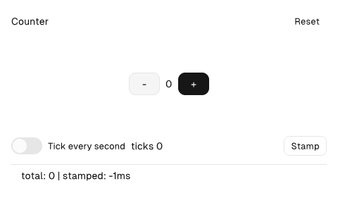

# Counter



The app-model teaching app: `Model`, `Msg`, `update` in one native
window, with a repeating timer on the effects channel (`fx.startTimer`)
and a journaled clock read (`fx.wallMs()`).

```sh
native dev     # build and run with markup hot reload
native test    # headless update-logic tests (src/tests.zig)
native check   # validate markup + manifest
```

See the root `README.md` for the full lineup.
