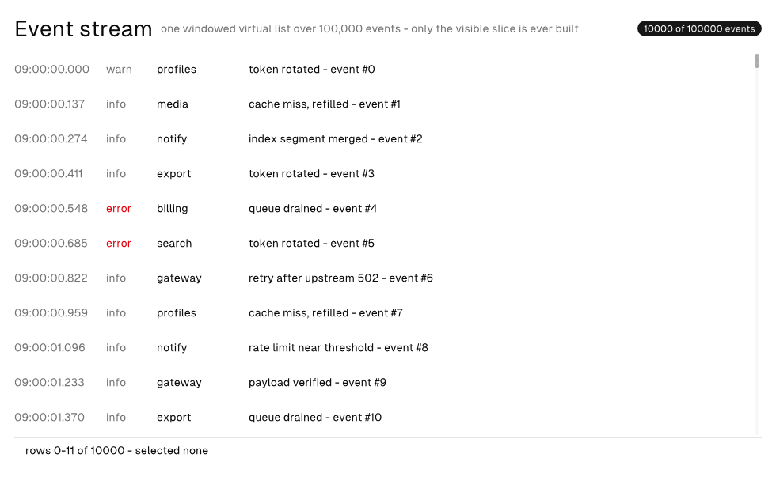

# Stream



A hundred-thousand-event telemetry feed rendered through **one
windowed virtual list**. The runtime owns the viewport math (retained
scroll offset + viewport → visible index range), the model owns the
corpus, and the view is the seam: the `rows` query materializes only
the range the runtime asked for, one keyed node each.

| Piece | Where |
|---|---|
| The window declaration | `<virtual-window id="stream" ...>` in `src/app.native` |
| The row query | `Model.rows` — `fn (model, range, arena) []const Row` returning exactly `range.end_index - range.start_index` rows |
| Infinite fetch | `on-reach-end="load_more"` — one Msg per approach, hysteresis built in |
| Window telemetry | the status bar reads `{range.first_visible_index}` / `{range.last_visible_index}` directly |

## The rules this app demonstrates

- **Rows are a pure function of the index.** A splitmix hash picks the
  source, level, and phrasing; the timestamp walks a fixed 137 ms
  stride from 09:00:00. The same index always renders the same event —
  tests assert exact strings, and the scrollbar geometry is honest
  arithmetic.
- **Only the window is built.** At 100,000 loaded events the mounted
  widget tree stays viewport-sized (~30 rows plus chrome); the tests
  count nodes to prove it.
- **The model owns the data; the view owns nothing.** `loaded` and
  `selected` are the only feed state; scroll offset lives in the
  runtime's retained state and is never echoed into the model.
- **Selection is keyed by item identity.** Rows key on `row.index`, so
  a row that scrolls away and back returns under the same structural
  id and its selection wash survives window shifts.
- **Uniform rows are the fast path.** `item-extent="44"` makes 100k
  rows pure arithmetic — no per-row measurement.

## Try it

```sh
native test    # the row math, batching clamp, and windowed tree bound
native check   # the typed model contract behind every binding
native dev     # scroll it: the status bar narrates the live window
```

Scroll to the bottom and the feed appends the next 10,000-event batch;
the corpus caps at 100,000.

With automation, the same story is greppable:

```sh
native automate widget-wheel main-canvas <list-id> 900000   # reach the end
native automate snapshot                                    # "of 20000 events"
```

## Markup notes

`<virtual-window>` declares the stable identity (`id`), the scope name
markup reads (`as`), the item count and extent, and the overscan.
`<virtual-list>` names the window, the model query (`each="rows"`), the
row scope (`as="row"`), and carries ordinary scroll attributes. The
list's one child is a **keyed** row template — one keyed root per row.
